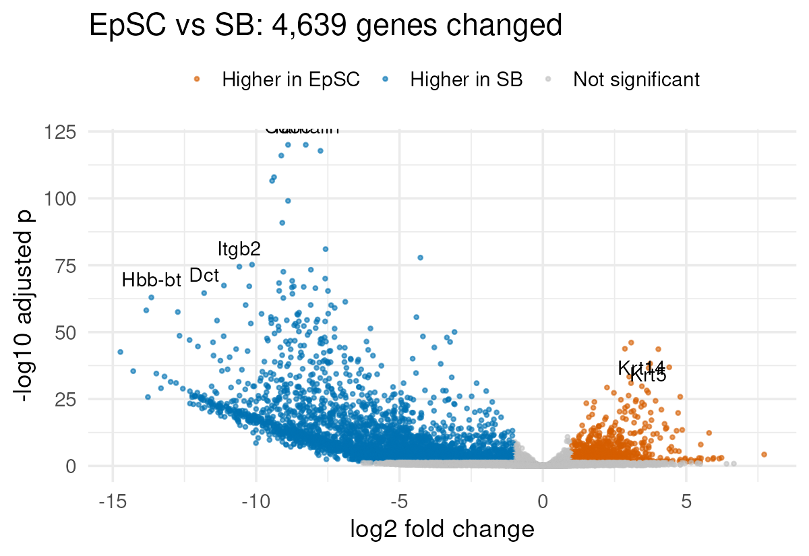
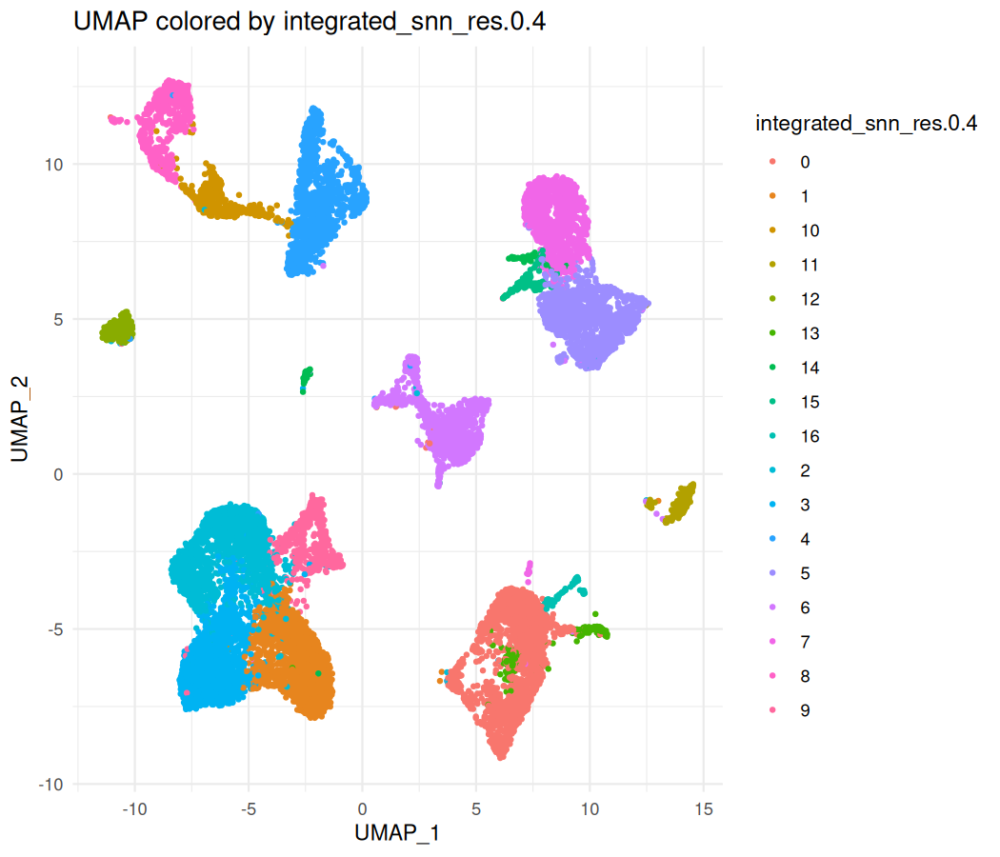

```{r setup, include=FALSE, purl=FALSE}
suppressPackageStartupMessages(require(knitr))
knitr::opts_chunk$set(echo = TRUE, tidy = T)
```

::: {.content-hidden when-format="revealjs"}
# Responsible Use of AI for Non-Coders: BRC and AI Tools
:::

## Overview

- [How the BRC uses AI](#how-the-brc-uses-ai)
- [Tools and resources from the BRC](#tools-and-resources-from-the-brc)
- [Working with the BRC](#working-with-the-brc)

??Suggested slide titles and content are below. Keep, cut or replace them. Everything in this section is a placeholder until you fill it.??

# BRC and AI tools {#how-the-brc-uses-ai background-color="#23373B" .center .middle}

## How the BRC uses AI

??How the BRC uses AI in its own work: where it helps and where we don't use it. Ties back to the strengths and limitations section, with one or two concrete examples from past projects (e.g. the SCENIC+ example).??

## What we have learned

??Lessons from using AI on core facility projects: what went well, what cost more time than it saved, and what we changed as a result.??

# Tools and resources from the BRC {#tools-and-resources-from-the-brc background-color="#23373B" .center .middle}

## BRC tools available through RU Claude

Rockefeller intends to make RU-developed methods, for example BRC's tools, available via RU Claude (see *AI Strategy at Rockefeller*).

??List the BRC tools and resources that will be available this way, how to access them and their current status (available now / planned).??

## The BRC plugin for Claude

Ask questions of your sequencing data **in plain English**. Claude finds the samples, runs BRC pipelines and writes the report.

```{mermaid}
flowchart LR
  U(["You<br/>'Compare EpSC vs SB<br/>and flag bad samples'"]) --> C["Claude +<br/>BRC plugin"]
  C --> S["<b>Skills</b><br/>BRC workflows<br/>and known pitfalls"]
  C --> M["<b>Connector (MCP)</b><br/>secure, scoped<br/>to your lab"]
  M --> D[("BRC data and compute<br/>pipeline samples · QC<br/>DESeq2 on the HPC<br/>lab expression matrices<br/>single-cell datasets<br/>IGV · BRC training")]
```

::::: {.content-visible when-format="revealjs"}
::: notes
The plugin bundles two things from the Customizing session: skills (how the BRC runs a DE analysis, which QC numbers matter, common traps such as reused sample names) and an MCP connector to the BRC server.
The connector only exposes defined tools: Claude can't browse the server freely. Access follows your lab login.
:::
:::::

## What you can do with it {.smaller}

:::: {.columns}

::: {.column width="50%"}
**Bulk RNA-seq**

- Find your lab's samples and sequencing runs
- **QC** every library and flag failed ones
- Run a **differential expression** report on the HPC (previewed first, run only with your OK)
- Pull top genes, filter to a gene family, check the biology
- Look up any gene across **every sample your lab has sequenced**
- Build an **IGV genome browser** view linked to the results
:::

::: {.column width="50%"}
**Single-cell RNA-seq**

- Browse the single-cell datasets the BRC hosts (76 today)
- QC per sample or donor, cells per cluster
- UMAPs, dot plots and violin plots
- Marker genes between clusters or conditions

**Everything**

- Answers backed by **BRC training material**, with links
- One shareable **report** at the end
:::

::::

## Example reports {.smaller}

Each one was made in a single Claude session with the BRC plugin.

:::: {.columns}

::: {.column width="50%"}
[{fig-alt="Volcano plot of 4,639 genes changed between EpSC and SB samples." height="320px"}](../../data/brc_reports/BRC_bulk_RNAseq_report.html){target="_blank"}

[**Bulk RNA-seq**](../../data/brc_reports/BRC_bulk_RNAseq_report.html){target="_blank"}: QC of 12 libraries (2 flagged), differential expression, and expression across 243 lab samples.
:::

::: {.column width="50%"}
[{fig-alt="UMAP of 15,457 human skin cells coloured by cluster." height="320px"}](../../data/brc_reports/BRC_scRNAseq_skin_report.html){target="_blank"}

[**Single-cell RNA-seq**](../../data/brc_reports/BRC_scRNAseq_skin_report.html){target="_blank"}: young vs aged human skin (public data): QC per donor, clusters, cell types and composition.
:::

::::

::::: {.content-visible when-format="revealjs"}
::: notes
Bulk data are real BRC pipeline data, anonymised for teaching (lab, user and sample names removed). The single-cell data are public: GSE130973, Solé-Boldo et al. 2020.
Points to make: QC caught two weak libraries from the same animal; keratins confirm the groups; the SB "signal" is largely immune/melanocyte cells, i.e. composition. In single-cell, T cells are 17-22% of young-donor cells vs 1-3% old, and one cluster is a single-donor artefact.
Both reports end with "check before you use": the AI ran BRC pipelines, the science is still yours.
:::
:::::

## Built for responsible use

- **Your data stay on BRC servers.** Claude sees only the summaries and plots it asks for.
- **Access follows your login**, scoped to your lab.
- **Nothing expensive happens without you.** Anything that uses HPC compute shows a preview and waits for your OK.
- **No invented numbers.** The plugin is told to copy every value from a BRC result, never from memory.
- **The science is still yours.** Statistical and biological judgement goes to you and BRC staff, not the AI.

Want to try it, or need an analysis reviewed? **brc@rockefeller.edu**

## Course and teaching materials

??Link to BRC training materials and how they can be used with AI tools (e.g. as context to supply in a prompt).??

## Skills, templates and shared configuration

??Examples of packaged instructions, project templates or configuration files the BRC provides so that everyone starts from the same good defaults. Links to the *Customizing Your LLM* and *AI in Your Workflow* sections.??

# Working with the BRC {#working-with-the-brc background-color="#23373B" .center .middle}

## When to talk to us

??When to contact the BRC: reviewing an AI-assisted analysis, choosing a method, setting up a reproducible workflow, a new tool you want to try.??

## Feedback and community contributions

??How to send feedback, request tools and contribute (the AI Strategy section says community contributions are welcome).??

## Contact

??Contact details and where to find BRC resources.??
