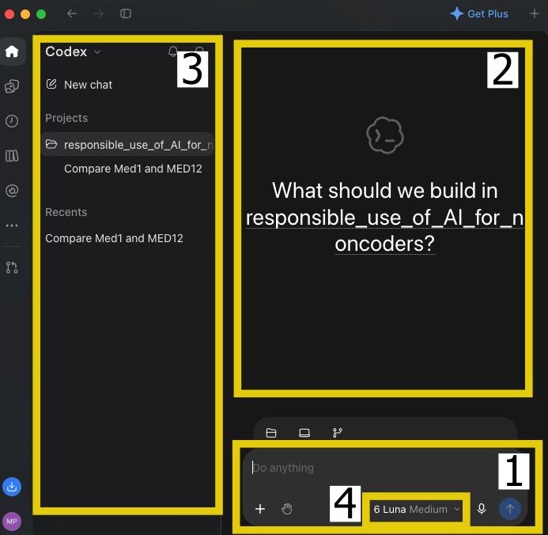
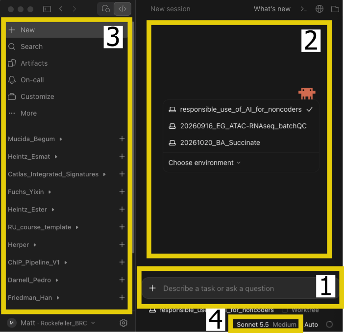
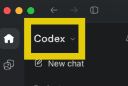
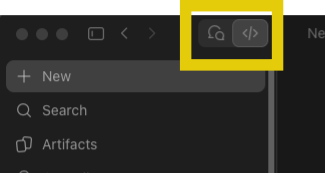
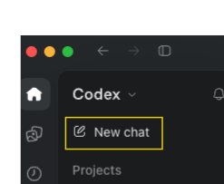
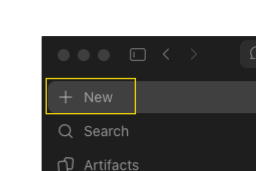
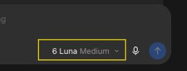
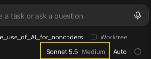

```{r setup, include=FALSE, purl=FALSE}
suppressPackageStartupMessages(require(knitr))
knitr::opts_chunk$set(echo = TRUE, tidy = T)
```

::: {.content-hidden when-format="revealjs"}
# Responsible Use of AI for Non-Coders: Interface Tour
:::

## Overview

A quick tour of two graphical apps side by side, **Codex** (left) and **Claude Code** (right). The features are largely the same in both. Knowing where they live is what matters. It's also okay to use the CLI if you prefer. 

- [Layout Overview](#layout)
- [Chat vs code](#chat-vs-code)
- [Projects](#projects)
- [Models and effort](#models)

# Interface tour {background-color="#23373B" .center .middle}

## The layout at a glance {#layout}

There are several key parts of the GUI. 

1. Prompt box: Where you type instructions.
2. Conversation Area: Where the model replies and informs you what it is doing.
3. Project Organization: Sidebar with your projects and past sessions.
4. Model picker: which model answers, and how hard it thinks.

## The layout at a glance - Codex

:::: {.columns}

::: {.column width="50%"}

{fig-align="center" width="70%"}

:::

::: {.column width="50%"}

1. Prompt Box
2. Conversation Area
3. Project Organization
4. Model Picker

::::


## The layout at a glance - Claude

:::: {.columns}

::: {.column width="50%"}

{fig-align="center" width="70%"}
:::

::: {.column width="50%"}

1. Prompt Box
2. Conversation Area
3. Project Organization
4. Model Picker

::::

## Chat vs code {#chat-vs-code}

Built-in to both GUIs are the more traditional chat-bot and the agentic-powered projects. 

- **Chat:** you ask, it answers. It cannot touch your files.
- **Code / agent:** it reads your files, runs commands and writes files on your computer.

The main difference is between asking a question and delegating a task, and it's where both the risk and possibilities lie.


## Chat vs code {#chat-vs-code2}
:::: {.columns}

::: {.column width="50%"}
**Codex**

{fig-align="center" width="70%"}
:::

::: {.column width="50%"}
**Claude Code**

{fig-align="center" width="70%"}
:::

::::

## Projects {#projects}

- The agent works inside the **folder you give it**. Choose it deliberately as th first step in providing the scope of files the agents can access.
- Each project has its own sessions (conversations) and, optionally, its own config files.
- **Never** point it at a folder holding raw data or anything you wouldn't want changed.

## Projects 

:::: {.columns}

::: {.column width="50%"}
**Codex**

{fig-align="center" width="70%"}
:::

::: {.column width="50%"}
**Claude Code**

{fig-align="center" width="70%"}
:::

::::

## Models and Effort {#models}

There are two dials for controlling the capabilities of the model for a task.

More advanced models and higher effort:

- Better for hard problems
- Slower
- More expensive/use more tokens

## Models and Effort

:::: {.columns}

::: {.column width="50%"}
**Codex**

{fig-align="center" width="70%"}
:::

::: {.column width="50%"}
**Claude Code**

{fig-align="center" width="70%"}
:::

::::

