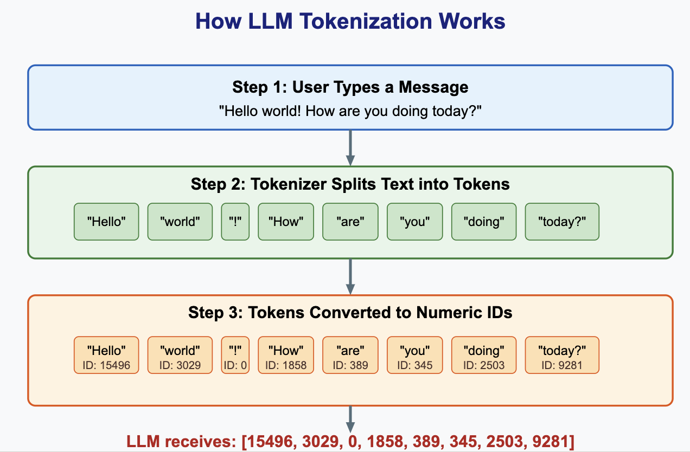
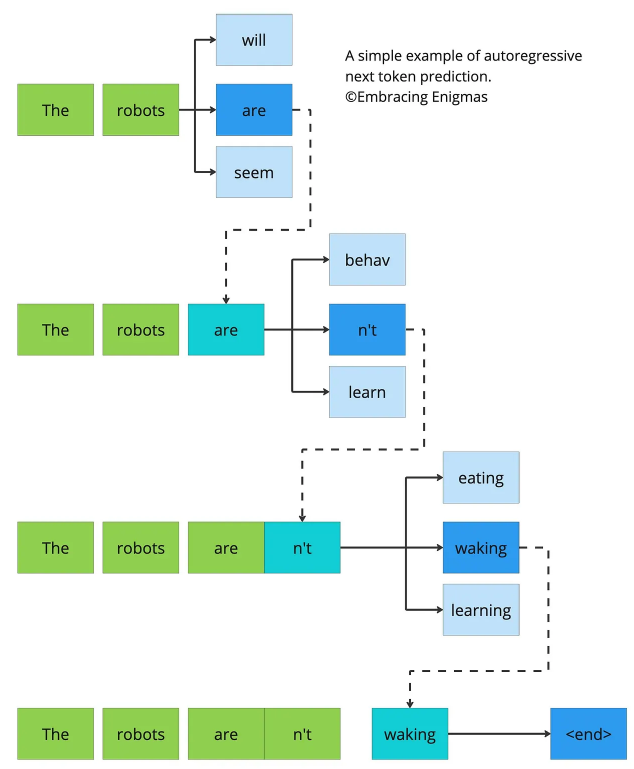
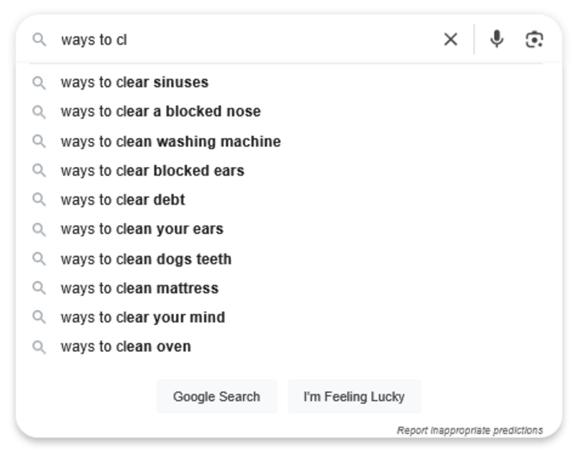
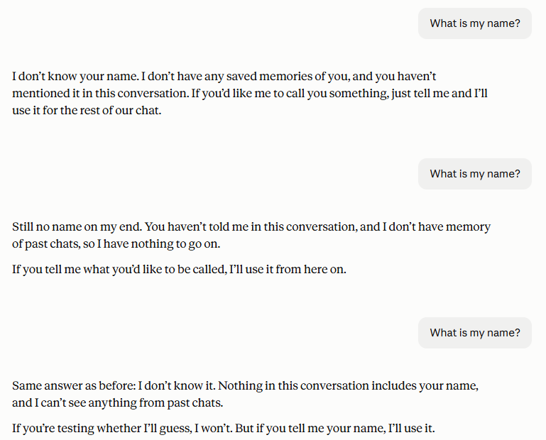
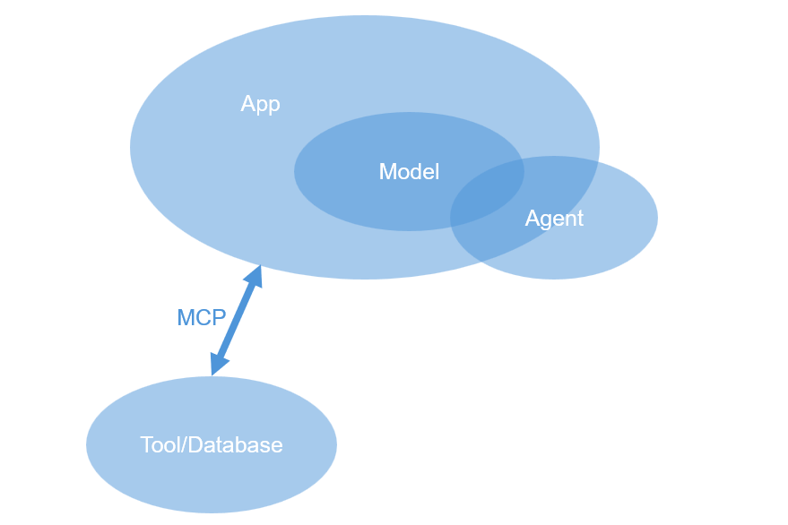

```{r setup, include=FALSE, purl=FALSE}
suppressPackageStartupMessages(require(knitr))
knitr::opts_chunk$set(echo = TRUE, tidy = T)
```

::: {.content-hidden when-format="revealjs"}
# Responsible Use of AI for Non-Coders: Basics of LLMs
:::

## Overview

*Presenter: Claire — 30 mins*

- [How models are built](#how-models-are-built)
- [Who runs the models](#who-runs-the-models)
- [Journal policies](#journal-policies)
- [Terminology](#terminology)

# How LLMs work {background-color="#23373B" .center .middle}

## What does an LLM do?

A large language model (LLM) creates a response based on a user-input *prompt*.

## Prompts

First, the model is provided with a prompt by the user. 

This could be a simple text-based request like "Draft an email to ___ about ___ topic." or "What are some good strategies for ___?".

It could also be a more complex prompt including other information such as code, images, videos, or numerical data. 

## Tokenization

This prompt is then *tokenized*, or reduced into more fundamental building blocks (letters, words, characters, etc.). 

Each token is then assigned a numerical *token ID*. Each LLM (Claude, Copilot, etc.) will have its own method of tokenization and assigning token IDs. 

This process is essential because neural networks cannot process letters or words; they operate entirely with numerical parameters.

These token IDs are then provided as inputs to a complex algorithm (neural network). The algorithm predicts the optimal output tokens given a set of input tokens.

## Visualizing Tokenization

{fig-align="center" width="80%"}

## Next Token Prediction

How does the LLM select these output tokens? One common method is *next token prediction*. Given some input tokens, the algorithm predicts the token most likely to occur next. It then uses this token along with the rest to find the next token in the sequence, and so on. 

{fig-align="center" width="50%"}

## Training 

You may have heard in the news that AI companies are using websites and print media to train their algorithms (sometimes without permission!). 

The weights of the next token prediction algorithm are calibrated using a *training dataset* as a template. 

Larger and more varied training datasets result in better-performing LLMs.

This stage is known as *pre-training* and results in a *base model* of the LLM.

## Fine Tuning

The base model is not suited for specialized applications, so further training must be undertaken. 

This can be supervised by humans and/or apply training datasets with more field-specific information. 

This is known as *fine tuning*.

The LLM can also be trained continuously on the interactions it has with users.

## Predictive Text on Steroids

The resulting LLMs are extremely sophisticated predictive text generators. 

{fig-align="center" width="50%"}

It is helpful to think of them in this way to conceptualize:

1. What tasks they are good at (writing, coding, sounding like a human).
2. What their fundamental limitations are (original ideas, thinking/reasoning, retrieving facts)

## Factual Responses

Since LLMs are probabilistic in nature, they may miss a correct answer because they think another answer is more likely. 

To retrieve a fact, you as a human might search in a database of existing information. The database may or may not contain the information you are looking for. 

The LLM operates in an entirely different way, and rather than pulling from a finite source of information, it generates results probabilistically based on its training data. 

This fundamental difference, combined with a predisposition for pleasing its user (sycophancy), may lead it to return an incorrect answer rather than admitting it doesn't have a solution.

## Determinism in LLMs

The algorithm used by LLMs is not deterministic. This means that a given input can result in a variety of outputs, both due to the inherent randomness of the algorithm as well as the use of previous queries to modify future results (as seen below). 

This is what makes chatting with a chat bot seem like you are talking to a human rather than a computer.

{fig-align="center" width="50%"}

**Think: what does this mean for its ability to do science or perform analysis?**

# The wider picture {background-color="#23373B" .center .middle}

## Who runs the models

The LLM tools commonly used today are owned by extremely powerful, multi-billion-dollar tech companies. These companies in general have: 

1. Shady records of respecting user data and privacy
2. Recent instances of models "going rogue"
3. New biomedical research programs
4. Access to all of the information you input to their models (and maybe some you don't give them access to)

## Recent LLM Headlines

, (2) [Meta fined $25bn for 'lies' over user data privacy](https://www.bbc.com/news/articles/cqdr8zxrr3dxo),  (3) [In a New Anthropic Lab, A.I. Turns to Biology](https://www.nytimes.com/2026/09/24/science/anthropic-biology-lab-enzyme.html), (4) [Some people's chats with Claude AI found to be publicly available online](https://www.bbc.com/news/articles/cly5qgjk5ywo), (5) [Did Anthropic’s A.I. Really Make a Scientific Discovery on Its Own?](https://www.nytimes.com/2026/09/27/science/anthropic-biology-enzyme-mestre.html), (6) [Anthropic's Claude AI escapes to hack into three organisations](https://www.bbc.com/news/articles/cz7dl7w8y7po)](headlines.png)

## LLM Access Restrictions

Unpublished research results or key progressions in valuable research

Unpublished manuscripts or grant proposals (especially if you are a reviewer!)

NEVER give LLMs access to PHI or PII (ex: patient health records, financial information, other identifying information)

## Caveat: Siloing

A caveat to some of these privacy concerns is *siloing*. 

RU has reached agreements with several AI companies (Anthropic/Claude and Microsoft/Copilot) so that data of users with RU emails will not be used to train models.

This is important because it prevents the leakage of private data and research ideas to other users of the LLMs. Always try to use enterprise models with your RU email address.

It is unclear whether the AI companies have control over the siloing of their models.

## Funder and Journal Policies

Funders: possible restrictions on preparing funding proposals with AI (ex: NIH). In general, use of AI to review proposals is *not allowed*.

Journals: may have to disclose AI use in writing and in analysis/results - check policy. In general, use of AI to review articles is *not allowed*.

The final responsibility for AI-generated results lies with you. This includes *plagiarism of text, code, or ideas*, hallucinated citations, and other errors. AI cannot be cited as a source or given authorship.

## Data Sharing

Funder mandates and best practices require sharing of detailed data and metadata in dedicated data repositories (ex: Zenodo, Dryad, GEO, etc.). Make sure that you are working with AI in a way that is documentable and reproducible.

DO: use AI to help generate metadata, analysis code/pipeline, READme files, etc. which can then be shared and used to recreate your process/results.

DON'T: use AI to perform an analysis of your data with no "paper trail".

# Terminology {background-color="#23373B" .center .middle}

## Terminology

- **Model** — the trained LLM itself (e.g. GPT, Claude Opus/Sonnet/Haiku).
- **App / product** — the interface you use to talk to a model (e.g. ChatGPT, Claude.ai). It adds features around the model such as memory, file upload and web search.
- **Agent** — a model given tools and allowed to take actions semi-independently over several steps (e.g. read files, run code, search the web) on your behalf.
- **Model Context Protocol (MCP)** - connects AI models to external resources such as databases or software tools

## How the pieces fit together

{fig-align="center" width="80%"}


