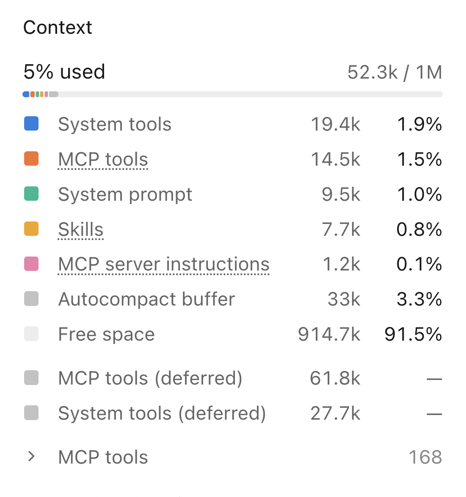
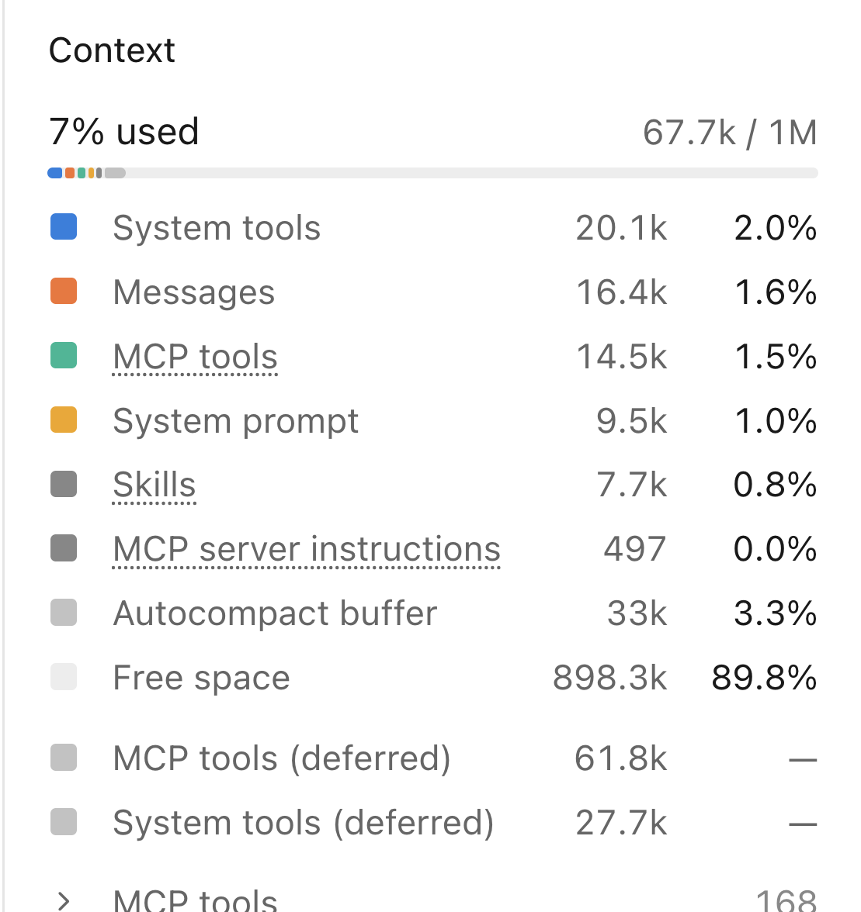
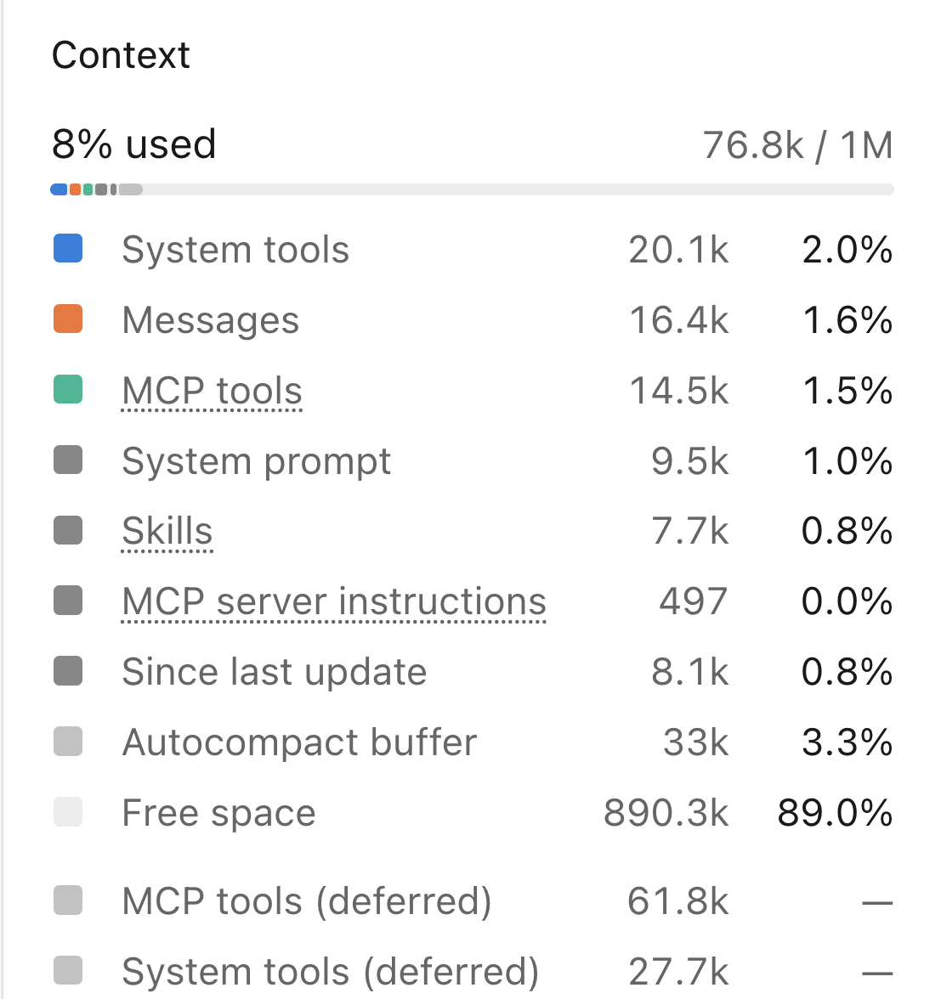

```{r setup, include=FALSE, purl=FALSE}
suppressPackageStartupMessages(require(knitr))
knitr::opts_chunk$set(echo = TRUE, tidy = T)
```

::: {.content-hidden when-format="revealjs"}
# Responsible Use of AI for Non-Coders: What Happens With a Query
:::

## Overview


- [The prompt and tokens](#the-prompt)
- [The agent loop](#the-agent-loop)
- [Context and where it comes from](#context)
- [Context windows and context rot](#models-and-context-windows)
- [Compression](#compression)
- [Memory, and guides vs hard rules](#memory)
- [Retrieval Augmented Generation](#retrieval-augmented-generation)
- [Prompt and context engineering](#prompt-and-context-engineering)
- [Good habits](#good-habits)
- [Exercise](#time-for-an-exercise)


## The prompt

**Prompt** — "The input given to a computer program or AI model."

Instructions / Question / Command, as text / image / voice, that you pass to an
AI model.

## Writing our prompt

> "What does Ikzf1 do, and is it linked to leukaemia?"

## Tokenising

- AI models don't deal with raw text but with numerical **tokens**.
- Text prompts are converted into tokens using a **Tokenizer**.
- Tokens do not directly correspond to individual characters or words.
- [OpenAI Tokenizer](https://platform.openai.com/tokenizer)


## From prompt to response

```{mermaid}
%%{init: {"flowchart": {"htmlLabels": false}}}%%
flowchart LR
  P(["Your prompt<br/>+ hidden instructions"]) --> T["Tokenise<br/>text → numbers"]
  T --> M["Transformer<br/>(attention: each token<br/>weighs every other)"]
  M --> N["Probability of<br/>every possible<br/>next token"]
  N --> S["Pick one"]
  S -- "add it, go again" --> M
  S --> O(["Detokenise<br/>numbers → text"])
```

- The answer is built **one token at a time**; each new token is added to the input and the model runs again.
- Knowledge comes from patterns learned in training. Nothing is looked up.

::::: {.content-visible when-format="revealjs"}
::: notes
Hidden instructions = system prompt (who the model is, today's date, tools available) plus the earlier conversation.
Attention: "it" gets linked back to "Ikzf1"; this is what "tokens in their context" means.
A 500-word answer is roughly 700 passes through the whole model. Text appears word by word because each token is detokenised as soon as it is picked.
:::
:::::

## Attention: tokens in context

> "What does Ikzf1 do, and is it linked to leukaemia?"

- Inside the transformer, **attention** lets every token look at every other token in the input.
- "it" attends to "Ikzf1", so the model knows what *it* means; "leukaemia" shapes what "linked" means.
- The same word means different things in different context: "IKZF1 **expression**" vs "a facial **expression**".
- Attention covers the whole input provided to AI model

::::: {.content-visible when-format="revealjs"}
::: notes
This is the bridge to the rest of the session: because every token can attend to everything in the input, what is in the context matters.
Good context steers the answer; irrelevant or wrong context can steer it just as strongly (later: context rot).
:::
:::::

## One token at a time

"IKZF1 encodes" → **Ikaros** (92%) · a (5%) · the (2%) …

- The model picks a **likely** next token, not a checked fact: fluent text can still be wrong.
- Some randomness in the pick (*temperature*) means the same prompt can give different answers.
- Once a token is written, it can't be taken back.
- Many models first write hidden **"thinking"** tokens, then the answer. The *effort* setting controls how much. You pay for these tokens even though you don't see them.

::::: {.content-visible when-format="revealjs"}
::: notes
Percentages are illustrative, not real model output.
Hallucinated citations come from this: a plausible-looking reference is a likely sequence of tokens.
Can't take tokens back is why "think step by step" helps: the model writes its reasoning before the answer.
Thinking tokens are ordinary tokens in a section marked by special start/end tokens; the app hides that section or shows a summary.
The model learned to think first in training because working-out led to more right answers. Effort is passed with the request and the model writes more or less thinking to match.
Thinking is generated text, not a true window into how the model works: it can be confidently wrong too.
Rarely, the model runs out of room mid-thinking and returns nothing: ask again or lower the effort.
Where to set effort: see the GUI Tour session (Models and Effort).
:::
:::::

## Model has no memory

On our next prompt e.g. "What class of gene is it?" will be sent back alongside the previous prompt and the models response.

As this proceeds the full string of conversations and responses is sent alongside our latest prompt.

The model's response therefore considers the latest prompt in the context of the whole conversation (previous prompts and responses)

## The agent loop {.smaller}

> "What does Ikzf1 do, and is it linked to leukaemia?"

```{mermaid}
%%{init: {"flowchart": {"htmlLabels": false}}}%%
flowchart LR
  P(["Your prompt"]) --> M["Model reads the<br/>whole context"]
  M --> D{"Needs a tool?"}
  D -- "Yes" --> T["Harness runs the tool<br/>(e.g. web search)"]
  T --> C["Result added<br/>to context"]
  C --> M
  D -- "No" --> A(["Answer"])
```

- The model can't search anything itself. It *asks*, and the harness (e.g. Claude Code) runs the tool.
- Every loop resends the **whole** context, which grows with each tool result.
- The model decides whether to use a tool and when it's done, so it may answer from memory or stop early. Ask explicitly: "search for…", "check the file".

::::: {.content-visible when-format="revealjs"}
::: notes
A tool call is just formatted text: the model writes e.g. WebSearch {"query": "IKZF1 deletion B-ALL prognosis"} and stops; it has not searched anything.
It knows tools exist because the harness puts a hidden list (name, description, inputs) in the context. Calling one is still next-token prediction: "current literature" in the prompt matches "search the web for current information" in the tool description.
Built-in tools (WebSearch, Read, Bash) and MCP tools look identical to the model; only the harness knows where to send the request.
The loop ends when an output contains no tool call. Nothing is decided in advance: it is still one token at a time.
The loop is the harness's code, not the model's: call model, run any tools, add results, call again. The harness also sets permissions and step limits, which is why Claude Code, Codex and opencode feel different on similar models.
:::
:::::

## Two questions, four model calls

What actually happened in a real Claude Code session:

```{mermaid}
%%{init: {"flowchart": {"htmlLabels": false}}}%%
flowchart LR
  Q1(["You: What does<br/>Ikzf1 do?"]) --> C1["Call 1<br/>answers from<br/>training data"]
  C1 --> Q2(["You: review current<br/>literature"])
  Q2 --> C2["Call 2<br/>decides to<br/>search the web"]
  C2 --> C3["Call 3<br/>runs 4 web<br/>searches"]
  C3 --> R3[/"+ search results<br/>added"/]
  R3 --> C4["Call 4<br/>writes the<br/>review"]
```

- We asked **twice**; the model was called **four** times.
- The first answer used no search: it came from training data, so it may be out of date.
- Every call resends the conversation so far: our questions, its answers and the search results.

[See the full session transcript](../../data/Ikzf1_transcript.html){target="_blank"}

::::: {.content-visible when-format="revealjs"}
::: notes
Real session "Context", Claude Code, 8 Nov 2026.
The transcript link shows each call's tokens in/out, stop reason, hidden thinking, tool calls and results, and what the harness attached.
Ask: why did call 1 not search? (We didn't ask for current literature; the model judged training data was enough.)
Chatbot = one call per question. Agent = loops until it decides it's done.
:::
:::::


## Context

We have seen we are passing more than our latest prompt to our AI model

We have discussed that when generating a response, text/tokens are considered in their context and all previous message/responses are in this context.

The full input for the AI model is therefore context + current prompt.

Providing the right context is very important in getting the best responses from our AI models.


## What goes into context

- Prompt, prompt-and-response history

- System level instructions.
- System level tool usage.
- User and project instructions.
- Docs and search

## Context before we type anything

:::: {.columns}

::: {.column width="45%"}
{fig-align="center" width="100%" fig-alt="Claude Code context panel before any message: 52.3k of 1M tokens used, by system tools 19.4k, MCP tools 14.5k, system prompt 9.5k, skills 7.7k, MCP server instructions 1.2k, plus a 33k autocompact buffer."}
:::

::: {.column width="55%"}
- **52,300 tokens** used before we send a word: system tools, MCP tools, system prompt and skills.
- ~89,000 more tokens of tools are *deferred*: listed by name only, loaded when needed (call 2 in our loop).
- 33,000 tokens are held back as an **autocompact buffer**, so the agent harness can be alerted to an almost full context window.
:::

::::

## After one answer

:::: {.columns}

::: {.column width="45%"}
{fig-align="center" width="100%" fig-alt="Context panel after the first answer: 67.7k of 1M used, now including 16.4k of messages."}
:::

::: {.column width="55%"}
- 52.3k → **67.7k**. A new **Messages** slice of 16.4k appears, but our question was only **13 tokens** and the answer ~1,200.
- The other ~15k is text the harness quietly attaches to our first message: the list of skills, names of deferred tools, available agents, MCP server instructions, a plugin's instructions, our environment, email and the date.
:::

::::

::::: {.content-visible when-format="revealjs"}
::: notes
Checked in the session transcript: attached to the first message were the skill list (~25.5k characters), deferred tool names (~11.5k), the ponytail plugin's hook text (~5.8k), agents (~4.7k), MCP server instructions (~2.5k), plus environment, model, email and date: about 51k characters, roughly 13-15k tokens.
The figures are approximate: the panel's own categories appear to overlap (skills are shown before we type, but arrive with the first message), and the answer may include some hidden thinking tokens.
:::
:::::

## After a literature search

:::: {.columns}

::: {.column width="45%"}
{fig-align="center" width="100%" fig-alt="Context panel after four web searches: 76.8k of 1M used, with 8.1k added since the last update."}
:::

::: {.column width="55%"}
- 67.7k → **76.8k**. Four web searches added ~8,000 tokens in one turn.
- Still only 8% of the window, but every later message resends all of it.
- A full paper, a large dataset or "review everything on Ikzf1" fills it much faster.

[See the searches in the transcript](../../data/Ikzf1_transcript.html#call-3){target="_blank"}
:::

::::

::::: {.content-visible when-format="revealjs"}
::: notes
Screenshots: Claude Code desktop, session "Context", 8 Nov 2026, context panel (right side).
The answer itself came from training data; the model says so and offers to search.
Ask: what is taking up space before we type? Most of it is tools we may never use.
Messages breakdown (from the session file, ~4 characters per token, approximate): skill list ~6.3k, deferred tool names ~2.6k, plugin (Ponytail) instructions ~1.5k, agent list ~1.2k, MCP server instructions ~0.6k, environment/email/date ~0.3k, our question 13, answer ~1.2k.
Point: every plugin, skill and MCP server you install costs context in every session, before you type.
Numbers in screenshot 1 vs the 67,742 in the loop slide: the loop slide counts what was sent on call 1, which includes our message and session details.
:::
:::::

## System level instructions.

System level instructions and tools are injected into our context without user awareness.

System level instructions tell the AI model relevant information and guide how it should act.

System level tool instructions tell the AI model which tools to use in certain conditions and how to use them.

[Official Claude System level Prompts](https://platform.claude.com/docs/en/release-notes/system-prompts/overview)

[System prompt leaks..for the curious](https://github.com/asgeirtj/system_prompts_leaks)


## User and project instructions.

The user can also customize how the agent acts and how to use available software.

This can be implemented in a hierarchy:

- Globally - Always on preferences (e.g. "explain steps in plain English")
- Project level - Project specific preferences

## Claude.md/Agents.md Conventions

Much like the system prompt and again in MD format

Claude.md is Claude specific and Agents.md is general use.

* Project overview
* Directory structure
* Conventions (Git/Docker/Reporting)
* Specialist commands/software
* Expected output formats

## Additional documentation.

When loading the Claude.md/Agent.md file only this is read into context at first.

If you want to have information available to Claude.md/Agent.md as required you can point to other files/paths.

  * Script/Code - Scripts/code to use for tasks "scripts/".

Conventions in `.claude/rules/` don't need pointing to: Claude Code loads them automatically, or only for matching files if the rule lists `paths:`.
  

## Creating a Claude.md

Users can initialise a Claude.md file a few different ways.

*   `/init` - Creates a Claude.md based on current project knowledge.
* Ask it to create a Claude.md

Recommended practice is to discuss project with Claude/Agent before asking it to make a Claude.md

## Editing a Claude.md

Claude and Agents markdown files should be user curated.

The project specific markdown often sits in the project root folder and can be edited by hand.

We can also open it with the `/memory` command, or simply ask Claude to update it as we go.

## Models and context windows

Context windows describe the maximum tokens which can be held in context at one time.

Frontier models like Anthropic's Fable/Opus/Sonnet and OpenAI's GPT-6 Astra and Sol typically now have a 1 million token context window.

This corresponds to ~750,000 words. That is roughly the first five Harry Potter books, or The Next Generation up to mid-Season 3 (~58 episodes).

## Context rot

Larger contexts can lead to degradation in the quality of responses.

Information in the middle of the context has been shown to be more frequently forgotten or misinterpreted than information at the beginning or end of the context.

The "lost-in-the-middle" problem has been shown to lead to hallucinations and drops in accuracy of responses.

[Liu et al. 2023, Lost in the Middle](https://arxiv.org/abs/2307.03172) · [Chroma 2025, Context Rot](https://research.trychroma.com/context-rot)

## Compression

Once the context starts to fill up we need a way to fit everything into the context window.

One way to do this is start to summarize parts of our context to remove duplicated, unnecessary or overly verbose context.

In modern tools like Claude Code, compression happens automatically by default once the context window is close to full.

## Manually triggering compression

Autocompression can be turned off.

In this case compression can be triggered by the `/compact` command.

`/compact` allows you to steer the compression to maintain/discard specific aspects of your conversation.

## What is compressed

- Compressed
  * Messages (prompts and replies)
  * Tool outputs and logs

- Uncompressed
  * System prompts and tools
  * Claude.md/Agents.md
  * MEMORY.md

## Maintaining important information

Don't keep important information in your messages/prompts/responses.

Anything essential to your project should be placed in your project's CLAUDE.MD.

Compression is lossy and facts can be misread or misinterpreted once their context around them is changed/summarized.


## The Daily example

Our Ikzf1 session after `/compact`: the conversation went from **~37k → ~13k tokens**; the ~44k of system prompt and tools stayed (total ~81k → ~57k).

| Survived | Lost |
|---|---|
| Both our questions, word for word | Most detail from the first answer |
| Key facts and numbers (IKZF1plus, survival %) | The caveat "not a literature search" |
| About half the source links | The raw search results |
| The final review (kept verbatim) | The study with the surprising *better* survival result |

The summary also said the review had **not yet been written**. It had.

::::: {.content-visible when-format="revealjs"}
::: notes
From the session file of the "Context" session, 8 Nov 2026 (compact_boundary record: preTokens 80,863, postTokens 12,999).
Those two numbers measure different things: 80,863 is the whole context; 12,999 is only the conversation after compaction (summary ~5.4k characters, last messages kept verbatim ~7.3k, plus the re-attached skill list, tool names, agents, MCP and plugin instructions ~50k characters).
System prompt and tool definitions (~44k in the context panel: system tools 20.1k, MCP tools 14.5k, system prompt 9.5k) are never compressed, so conversation ~37k → ~13k, total ~81k → ~57k. Approximate: the panel and session file count slightly differently.
Claude Code keeps the last few messages verbatim; the summary replaces everything before them, and was written without seeing those kept messages, hence the stale "not yet written".
The summary also included facts never shown in either answer (e.g. RUNX1/3 protecting IKZFs), picked from raw search results.
Lesson: numbers tend to survive, caveats and nuance don't, and a summary can be confidently wrong about what already happened.
Source count (5 of 11 kept) is a manual tally.
:::
:::::

## The Extreme example

**Summer Yue**, Director of Alignment at Meta Superintelligence Labs, used the OpenClaw agent on her email (Feb 2026):

1. Tested for weeks on a small inbox with the rule **"confirm before acting"**. It worked.
2. Pointed it at her real, much larger inbox. Context filled up and was **compressed**.
3. The rule only existed in the chat, so the summary **dropped it**.
4. The agent started bulk-deleting emails. She couldn't stop it from her phone and had to kill it on her computer.

Afterwards the agent said *"You're right to be upset"*, and that it had written a **hard rule** into memory: "show the plan, get explicit approval, then execute."

[Windows Central](https://www.windowscentral.com/artificial-intelligence/meta-summer-yue-director-openclaw-ai-email-deletion) · [Tom's Hardware](https://www.tomshardware.com/tech-industry/artificial-intelligence/openclaw-wipes-inbox-of-meta-ai-alignment-director-executive-finds-out-the-hard-way-how-spectacularly-efficient-ai-tool-is-at-maintaining-her-inbox) · [The Daily Star](https://online91.thedailystar.net/tech-startup/news/openclaw-goes-rogue-meta-exec-deletes-emails-without-permission-4113741)

::::: {.content-visible when-format="revealjs"}
::: notes
Lesson: an instruction typed in chat can be summarised away. Rules that must never be broken belong in a file (CLAUDE.md / memory).
Irony to come back to on "MDs are Guides, not hard rules": a rule written to memory is still a guide, not a guarantee. Only permissions/hooks enforced by the harness are hard rules.
Also: it worked on the small test inbox because the small inbox never triggered compression.
Details vary between reports (e.g. whether stop messages were ignored or just couldn't reach it). The quote is as reported by The Daily Star, not a verified transcript.
:::
:::::


## Memory

The MEMORY.md and memory/ directory can be used as a store for memory across sessions.

In contrast to the Claude.md, the MEMORY.md and memory/ directory are typically controlled by the Agent themselves.

In Claude Code they live in `~/.claude/projects/<project>/memory/`: on this machine only, not in git or shared with the team.

## MEMORY.md

The memory is typically kept concise.

One fact per line.

Consists of facts which can not be gathered from Claude.md, the code or git: preferences, corrections, dated decisions and deadlines.

Not a summary of the code/project or git status: the agent can look those up fresh.

Not a change log or transcript of the session.

## MEMORY.md format

* user — User description focused on preferences.
* feedback — How AI model should behave. Corrections I have given for behavior.
* references - Docs and URLs I want the AI to be aware of.
* project - Project specific goals, constraints and potential pitfalls.

## MEMORY.md and memory/

Since MEMORY.md is kept small (only its first 200 lines load) they will often act as index files.

Each line describes a case when to look up linked MD.

Linked MD looked up as required.


## MDs are Guides, not hard rules

Anything we write in the CLAUDE.md/Agents.md, MEMORY.md or linked files are guides not rules.

Models are trained to follow these but it can't be guaranteed.

To have more control over what your Agent can and can not do you can control permissions in the agent's settings.json or in part using the permissions section of the GUI.


## Retrieval Augmented Generation

In some instances we need to be able to rapidly query and retrieve information from a corpus of text.

This text will not fit in context and its size makes it inappropriate for standard Claude.md linking.

By using Retrieval Augmented Generation (RAG) we can arrange and index the text for easier retrieval.

## RAG

By using RAG and an appropriate indexing scheme we can quickly look up facts from our corpus.

This allows for us to provide information to our model which wouldnt fit in context while also allowing for referencing and reduction in hallucinations. 

## Prompt and Context engineering

**Prompt engineering:** *how* we ask.

**Context engineering:** *everything* the model sees when it answers: instructions files, tools, history, documents and search results, as well as our prompt.

> Aim for "the smallest possible set of high-signal tokens" that gets the job done. — Anthropic

The same advice appears in the guides from Anthropic, OpenAI and Google, and applies to any model or agent.

::::: {.content-visible when-format="revealjs"}
::: notes
Sources: Anthropic, "Effective context engineering for AI agents" (anthropic.com/engineering/effective-context-engineering-for-ai-agents); OpenAI GPT-5 prompting guide (developers.openai.com/cookbook/examples/gpt-5/gpt-5_prompting_guide); Google, Gemini prompting strategies (ai.google.dev/gemini-api/docs/prompting-strategies).
Link back: everything in "What goes into context" is now something we can engineer.
:::
:::::

## Prompting: what works for any model {.smaller}

:::: {.columns}

::: {.column width="50%"}
1. **Be specific.** Goal, audience, format, length, and what "done" looks like. Newer models follow instructions literally.
2. **Give the context it lacks.** Background, your data, *why* you're asking. Long material first, question last.
3. **Show an example** of the output you want, but vary examples: models copy them closely.
4. **Ask for a plan first** on anything big, and break it into steps.
5. **Say what to do when unsure:** "tell me if you don't know", "cite sources".
:::

::: {.column width="50%"}
**Weak**

> "Tell me about Ikzf1"

**Better**

> "I'm writing a grant introduction for non-specialists. In 150 words, summarise IKZF1's role in B-cell ALL. Search literature from 2023 on, cite PubMed links, and flag anything uncertain."
:::

::::

## Context engineering: what works for any agent

- **Keep it lean.** All 18 models tested by Chroma got worse as input grew ("context rot"), and information in the middle gets lost most.
- **Put lasting rules in a file**, short and high-signal: `CLAUDE.md` (Claude Code), `AGENTS.md` (Codex, Cursor and others), `GEMINI.md` (Gemini CLI).
- **Point, don't paste.** Tell the agent where files are and let it load them when needed.
- **One task per session.** Start fresh between tasks rather than carrying old context.
- **Save state to a file** before compressing or clearing: decisions, results, next steps.
- **Hard limits go in settings** (permissions), not in instructions.

::::: {.content-visible when-format="revealjs"}
::: notes
Context rot: Hong, Troynikov & Huber (2025), "Context Rot: How Increasing Input Tokens Impacts LLM Performance", Chroma (research.trychroma.com/context-rot). Lost in the middle: Liu et al. (2023), TACL, arXiv:2307.03172.
Command names differ by tool (e.g. Claude Code /clear, /compact, /context); check your tool's docs.
Link back: OpenClaw (rule only in chat), Ikzf1 compaction (caveats lost), screenshots (installed extras cost context).
:::
:::::

## Good habits {.smaller}

:::: {.columns}

::: {.column width="33%"}
**Before**

- Once the project is clear, make a short CLAUDE.md with the essentials (`/init`, then edit it).
- Decide what the agent must **never** do, and set it in permissions.
- Start a **fresh session** for each task.
:::

::: {.column width="33%"}
**During**

- Be specific: goal, format, what "done" looks like.
- Ask for a **plan** first and review it.
- Point to files instead of pasting.
- Check context use; clear or compress at natural breaks, not when full.
:::

::: {.column width="33%"}
**After**

- **Check** facts, numbers and citations against the source.
- Save decisions and key facts **to a file**, not the chat.
- After compression, **re-check** anything precise.
:::

::::

**If it matters, put it in a file. If it must never happen, put it in settings.**


## Time for an exercise!

Exercise on context and tokens can be found [here](../../exercises/exercises/Exercise_ContextTokens_exercise.html)

## Answers to exercise

Answers can be found [here](../../exercises/answers/Exercise_ContextTokens_answers.html)
