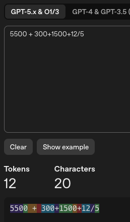

```{r setup, include=FALSE, purl=FALSE}
suppressPackageStartupMessages(require(knitr))
knitr::opts_chunk$set(echo = TRUE, tidy = T)
```

::: {.content-hidden when-format="revealjs"}
# Responsible Use of AI for Non-Coders: What AI Is Good and Bad At?
:::

## Overview

- [What works](#what-works)
- [What is a struggle](#what-is-a-struggle)
- [Models are static](#models-are-static)
- [Minor methods](#minor-methods)
- [Bioinformatics-specific pitfalls](#gene-symbols)
- [Hallucinations](#hallucinations)
- [Other limitations](#other-limitations-that-follow-from-how-llms-work)
- [Exercise](#time-for-an-exercise)

# Strengths and limitations {.center .middle background-color="#23373B"}

# Strengths and limitations

In our experience we have seen these LLMs really accelerate our work in certain areas.

That said for other tasks they really fall down as they end up costing more time and/or give inaccurate results.

Often by bearing in mind how these tools are built, we can understand where they excel and where they fail.

## The one idea to keep in mind

REMEMBER: An LLM predicts the most plausible next piece of text given what it has seen in training and what you have put in the prompt.

So it is most useful when:

1.  The task looks like **lots of text it has seen before**
2.  **Everything it needs is in the prompt**: (the less it has to infer the better)
3.  **You can check the output** quickly

It does worse when one or more of these conditions are not met.

```{mermaid}
flowchart LR
  A(Known Task) --> B(All Context Provided)
  B --> C(Verifiable Output)
```

# What works {#what-works .center .middle background-color="#23373B"}

## What works

- Code review
- Generating more intuitive reports
- Regular workflows, standardized outputs
- Enhancing code with tests and messaging
- Modernizing old tools

## Why do these work

| Task | Why it suits an LLM |
|------------------------------------|------------------------------------|
| Code review | Common bugs and idioms are very well represented in training data (which has quality production level code) |
| Intuitive reports | Turning structured results into readable text and figure legends is a language task |
| Regular workflows, standardized outputs | The same pattern repeated many times. We also allocate more time to reviewing pipelines and have distinct expectations. |
| Tests and messaging | Production level code has lots of messaging (`stopifnot()`, `tryCatch()`, log messages) and its easy to verify by running it |
| Modernizing old tools | Translating between two well-documented styles or languages (e.g. base R to tidyverse, Perl to Python) is close to translation between languages |

## Why do these work

- [Modernizing old tools](https://seqera.io/blog/rewrites-bio/)

This blog post presents an interesting discussion and starting point for how to improve code and software using AI.

What it boils down to though is testable outcomes and responsible stewardship of methods. As writing good code gets easier, the emphasis is on ensuring good biology.

# What is a struggle {#what-is-a-struggle .center .middle background-color="#23373B"}

## What is a struggle

- Complete multi-faceted analysis

- Highly dynamic or novel tools

- Rarely used or minor tools

- Specific issues:

  - Gene symbols - Sometimes gets confused as symbols update over time.
  - Numeric Hallucinations - row verification
  - Mixing up annotations

# Complete Analysis {.center .middle background-color="#23373B"}

## Complete Analysis

Asking for an entire analysis in one go ("here is my data, find the differences and write it up") is where errors are least visible and most costly. This and reproducibility is what we in the BRC worry about the most.

- **Errors compound.** A multi-step analysis is a chain of related but distinct tools: if each step is 95% likely to be right, ten steps in a row are right only about 60% of the time (0.95\^10 ≈ 0.60) — and you can't tell which step went wrong.

- **Hidden decisions.** Filtering thresholds, normalization, which samples to include and which statistical test to run are scientific choices. A model will make them silently, picking whatever is most typical, not what is right for your design.

- **No ground truth.** The model cannot see that a PCA looks wrong or that a result is biologically implausible unless you show it.

- **Long sessions drift.** Early instructions and decisions get diluted as the conversation grows. We talked about this in relation to *Context Limits*

## Complete Analysis

**A better way:** break the analysis into steps, decide the scientific choices yourself, and check each step before moving on.

::: {.callout-note title="Bioinformatic principles still apply even when running LLMs"}
If you do not have the knowledge/experience to make choices about your data then do more reading, review a known published dataset with your workflow or talk to someone who does. This standard bioinformatics approach does not change whether you are using LLMs or not.
:::

## Complete Analysis

```{mermaid}
flowchart TB
  subgraph ONE ["One big prompt"]
    direction TB
    L1["Prompt 1<br/>Complete a scRNAseq analysis on this mouse PBMC dataset"]
    L2{{"Review results"}}
    L1 --> L2
  end

  subgraph STEP ["Step-by-step with checkpoints"]
    direction TB
    R1["Prompt 1<br/>With this scRNAseq mouse PBMC dataset read the cells into Seurat in R and do some basic QC. Make a report."]
    R2{{"Review report<br/>Any QC concerns?"}}
    R3["Prompt 2<br/>Add filtering for cells with mt rate > 1, regress out cell cycle,<br/>and check for doublets using Scrublet."]
    R4{{"Re-review results"}}
    R5(["...and many more steps"])
    R1 --> R2
    R2 --> R3
    R3 --> R4
    R4 -.-> R5
  end

  classDef prompt fill:#23373B,stroke:#23373B,color:#ffffff
  classDef review fill:#EB811B,stroke:#EB811B,color:#000000
  classDef more fill:#ffffff,stroke:#999999,stroke-dasharray: 5 5,color:#555555
  class L1,R1,R3 prompt
  class L2,R2,R4 review
  class R5 more
```

# Models are static {#models-are-static .center .middle background-color="#23373B"}

## Models are static

A model's knowledge is fixed at its training cutoff. Unless the application you are using adds additional information (e.g. via web search), it does not know about anything after this point.

There is typically a 3-6 month lag between the fixation of the training data and the model release. These models will then be used for months if not years.

The model itself does not learn from your conversations while you use it. Each model is a fixed snapshot. Improvements come as a *new* model, not an update to the one you are using.

## Static: the timeline

If you work with Claude in summer 2027 you could be using an LLM trained on data that is from \>= 1 year old.

| Claude Opus 5.5      | Date                              |
|----------------------|-----------------------------------|
| Training data cutoff | June 2026                         |
| Released             | 22 September 2026                 |
| Earliest retirement  | not sooner than 22 September 2027 |

*Dates from Anthropic's [models overview](https://platform.claude.com/docs/en/about-claude/models/overview) and [Transparency Hub](https://www.anthropic.com/transparency).*


## Models are static

This causes LLMs to struggle sometimes in specific cases:

- Brand-new tools, packages or new software versions
- Changes to databases, annotations or guidelines
- Recent news and publications

Example - SCENIC+ 

* Software used to generate gene regulatory networks from scATAC/RNAseq data.
* They did a major package update with new ways to run and install the software. 
* Claude could only "see" the old one. It could not support us with installation. 
* Using Claude to double-check the results it suggested an inverted way to interpret the results. This would not have been caught without reading the newest handbook.

## Static: what to do about it

- **Give it the current documentation.** Provide the link to the vignette, README or release notes into the prompt — the model can use what is in front of it far more reliably than what it half-remembers.
- **Turn on web search** if your app has it, and check the sources it cites.
- **Check versions.** Ask which version of a package the answer applies to, and compare with `packageVersion()` / `--version` on your system.
- **Treat "it worked before" with suspicion** when a tool has had a major release.

?Link to the context section on supplying context.?

## Minor Methods

There are many packages that are used by large numbers of people and have wide spread documentation/code online i.e. samtools, Seurat, BWA etc. Often though we are working with edge cases, and methods used by a small number of people.

This problem gets worse if there is a similar analogous package that has a monopoly.

## Minor methods: why it happens

LLMs learn facts in proportion to how often they appear in training data. Facts that appear rarely — the "long tail" — are learned poorly, and the model will fall back on something similar it has seen far more often.

- Lab-specific or niche packages have few/no examples in the training set, so the model fills gaps with plausible-looking code.
- A niche tool next to a dominant one: it gives you the **dominant tool's** arguments and workflow, with the niche tool's name on it (e.g. Seurat terminology for a lesser-known single-cell package).
- Small-community tools may have little documentation beyond the paper.

## Minor methods: why it happens

*Research on this: [Kandpal et al. 2023, "Large Language Models Struggle to Learn Long-Tail Knowledge"](https://arxiv.org/abs/2211.08411) — accuracy on a question tracks how many times the relevant fact appears in the training data.*

```{r longtail, echo=FALSE, warning=FALSE, message=FALSE, fig.width=9, fig.height=4.5}
# Pulled live from Bioconductor each time the slides are built
suppressPackageStartupMessages({library(ggplot2); library(dplyr); library(ggrepel)})
scores <- read.delim("https://bioconductor.org/packages/stats/bioc/bioc_pkg_scores.tab", stringsAsFactors = FALSE)
scores <- scores |> arrange(desc(Download_score)) |> mutate(rank = row_number())
lab <- filter(scores, Package %in% c("limma", "DESeq2", "scran", "DropletUtils", "scHiCcompare"))
ggplot(scores, aes(rank, Download_score)) +
  geom_area(fill = "grey85") +
  geom_point(data = lab, colour = "#EB811B", size = 3) +
  geom_text_repel(data = lab, aes(label = Package), seed = 42, min.segment.length = 0,
                  nudge_x = 300, direction = "y", hjust = 0) +
  scale_y_continuous(labels = scales::comma) +
  labs(x = "Package rank (most to least downloaded)", y = "Bioconductor download score",
       title = "Bioconductor packages: a long tail of usage") +
  theme_minimal(base_size = 14)
```

*Download score is a proxy for how much code and documentation exists online, not a measure of what any model saw in training. Data: [Bioconductor package statistics](https://bioconductor.org/packages/stats/bioc/bioc_pkg_scores.tab).*

**What to do:** supply the documentation or source code, and check every function argument against the actual help page.


# Science-specific issues {#science-specific-issues .center .middle background-color="#23373B"}

## Numeric hallucinations

LLMs don't typically directly calculate. They predict what text a calculation result would look like. Numbers are also split into small text pieces ("tokens"), which does not help. They are getting better, but the [accuracy is still not high enough (70-90%)](https://dojolabs.co/blog/openai-vs-claude-ai-math-accuracy-comparison/?st_source=ai_overview) to directly do calculations.

- Counts, means, p-values, fold-changes and percentages in a model's *prose* may be invented or subtly wrong — and still look right because they will be approximately right. 
- The risk is highest when you ask it to summarize or read a table: it may drop rows, merge them or write plausible numbers.
- Long tables and many rows make this worse.

## Numeric hallucinations

:::: {.columns}

::: {.column width="55%"}
**What to do:**

- Have the model **write code** to calculate (and run it), rather than state numbers.
- Do **row verification**: compare row counts in and out, spot-check several values against the source, and don't rely on it for anything substantial.
- Never paste a number from a chat answer into a report without tracing it back to code you ran.
:::

::: {.column width="45%"}
{fig-alt="Screenshot of an online tokenizer showing the text 5500 + 300+1500+12/5 split into 12 coloured tokens."}

This is the [OpenAI tokenizer](https://platform.openai.com/tokenizer)
:::

::::

## Gene symbols 

Gene symbols are not stable identifiers, and a model trained on a mix of old and new literature has seen all versions.

- Official symbols change: e.g. `SEPT1` was renamed `SEPTIN1` and `MARCH1` was renamed `MARCHF1` by HGNC (partly to stop spreadsheets turning them into dates).
- Aliases and old names are common in older papers, which are a large part of the training data.
- The same symbol can mean different genes in different species, and capitalization conventions differ (human `TP53`, mouse `Trp53`).
- Orthologs are not always 1:1.

## Gene symbols 

**What to do:** use stable IDs (Ensembl, Entrez) for joining and checking, take symbol \<-\> ID mappings from a versioned annotation (e.g. the `org.*.eg.db` or `biomaRt` release you are actually using), and never ask the model to "recall" a mapping. Save a fixed copy of these SYMBOL to ID mappings. 

*Related reading: Ziemann et al. 2016, "Gene name errors are widespread in the scientific literature", Genome Biology; HGNC ([genenames.org](https://www.genenames.org/)).*

?Screenshot: example of the model returning an outdated or wrong symbol/alias for a gene from your own experience, or from a quick test with a renamed gene.?


## Mixing up annotations

Annotation versions are exactly the kind of detail that is easy to blur: they look alike and appear throughout the training data.

- Genome build: hg19 vs hg38 (and mm10 vs mm39) — coordinates are not interchangeable.
- Annotation source and release: Ensembl vs GENCODE vs RefSeq; Ensembl release 98 vs 110.
- ID types: Ensembl ID, Entrez ID, symbol, UniProt — and version suffixes (e.g. `ENSG00000141510.18`).
- Mapping one resource's categories onto another's.

**What to do:** state the build and annotation release in the prompt and check it appears in the answer, ensure the code generated matches expectation, keep these in your project documentation so they are not left to the model to guess, keep a static version available locally that you use consistently with documentation of how it was sourced.

?Screenshot some reference versions on a webpage?

# Hallucinations {#hallucinations .center .middle background-color="#23373B"}

## Hallucinations

A **hallucination** is a seemingly coherent and confident answer that is wrong. Generally with newer models these occur less frequently, but they are still a concern when we are working in Science where we rely on a higher threshold of confidence then other fields.

Examples:

- **Invented references.** Authors, titles and DOIs that look real but do not exist. (One study of ChatGPT-generated citations found a substantial proportion fabricated and many more with errors: Walters & Wilder 2023, *Scientific Reports*.)
- **Invented arguments or functions.** A plausible-sounding argument that does not exist in your installed version of the package.
- **Invented biology.** A confident description of a gene's function or a pathway, with no source.
- **Invented numbers.** See above.

## Why is it so confident?

Because the model is trained to produce plausible text, a wrong answer can read exactly like a right one. Confidence in the wording is not evidence of correctness.

- **There is no look-up.** The model does not retrieve facts from a database of known truths. Instead it generates text token by token. When it doesn't "know", it generates the most likely-looking answer anyway. There is no confidence score to help you evaluate it's response.

- **Training and benchmarks reward guessing.** Models are scored on how often they answer correctly. "I don't know" scores zero, so guessing is the better strategy — and models learn to guess. (Kalai et al. 2025, "Why Language Models Hallucinate", [arXiv:2509.04664](https://arxiv.org/abs/2509.04664).)

- **Wording style has nothing to do with accuracy.** The model writes in the same tone whether it is right or wrong. That tonal nuance that we important when we work with colleagues, but missing when working with LLMs.

? Examples?


